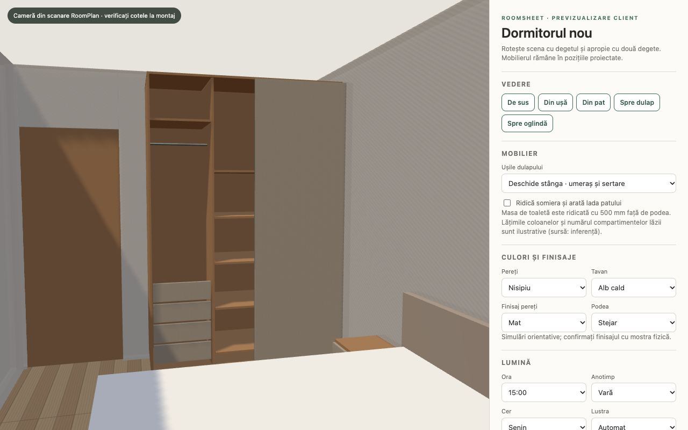
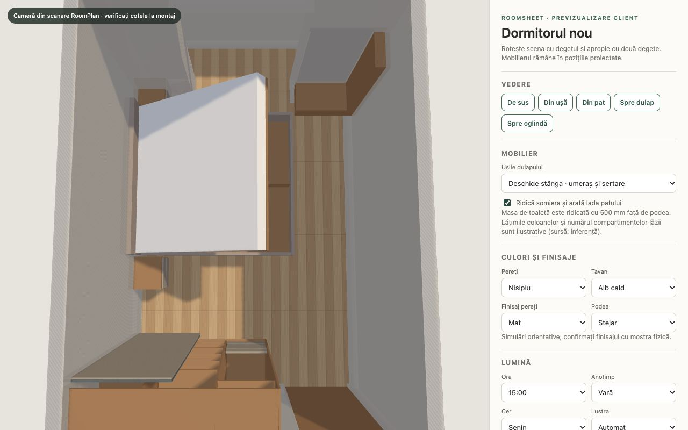
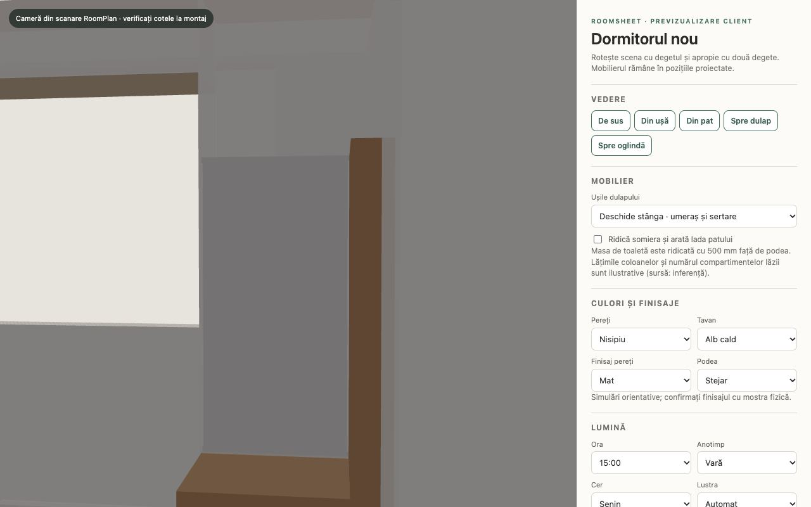

# Parcursul demonstrației M-DEMO

> **Actualizare 26 noiembrie:** patul a fost mutat pe peretele de lângă dulap; verifică poziția și culoarul de 440 mm pe plan și cu ruleta înainte de montaj. Vezi [STATUS.md](STATUS.md).

1. Pornește Studio cu `npm run dev` și importă `reference/captured-room.json`. Arată dimensiunile rezultate și faptul că scanarea incompletă din `reference/fixtures/captured-room-partial.json` este respinsă explicit.
2. Încarcă mostrele comenzii. Scena conține dulapul, patul, două noptiere și masa de toaletă; comoda scoasă din comandă nu apare. Deschide separat stânga și dreapta dulapului, apoi ridică somiera pentru lada compartimentată. Lățimile coloanelor și numărul compartimentelor sunt ilustrative.
3. În **Verificări**, arată rezerva de **22 mm** pe segmentul de 792 mm pentru masa de toaletă și spațiul de **234 mm** dintre dulap și golul ușii. Rezerva de 22 mm cere confirmare cu ruleta; golden file-ul scanării nu dovedește precizie fizică.
4. În **Vedere**, schimbă cele cinci puncte de observație și rotește scena prin tragere. Pe telefon, gestul cu două degete schimbă apropierea; validarea pe dispozitiv real rămâne de făcut.
5. În **Lumină**, compară vară la 12:00 cu iarnă la 20:00, apoi comută cerul, lustra, temperatura becului și LED-urile oglinzii. În **Culori**, schimbă pereții și tavanul. În Studio, schimbă poziția unei piese sau adaugă o cotă măsurată cu ruleta pentru avertismentele de control.

Valoarea demonstrată față de un export generic PRO100 este plasarea mostrelor în scanarea camerei, controlul luminii după oră/anotimp, mobilierul interactiv și avertismentele numerice de încadrare. Nu revendicăm o calitate de randare superioară. Exportul interactiv este disponibil la linkul din `docs/PRESENTATION.md`; testele în mesagerie pe telefoane reale rămân de făcut.
