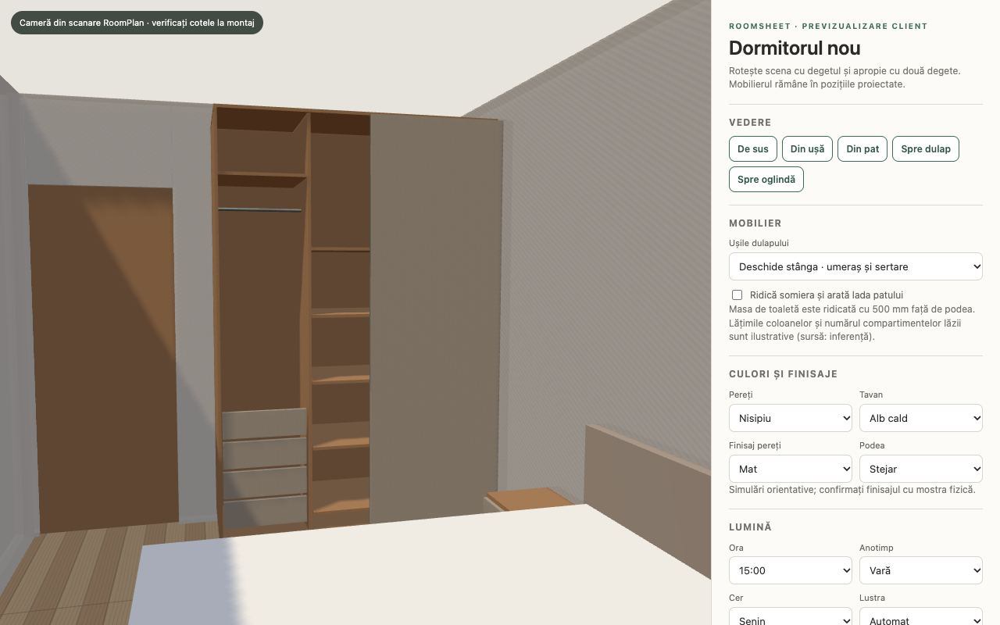
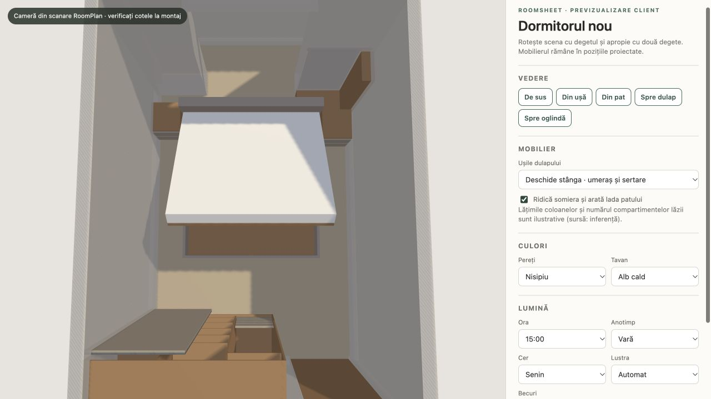

# Prezentarea din 24 noiembrie 2026

## Deschidere rapidă

- Pagina client găzduită: https://igortacu.github.io/roomsheet-preview-019c3bbad77eecba/
- Rezervă locală: `dist/demo-client/roomsheet-demo.html`, deschis în browserul laptopului.
- Studio pentru importul scanării și avertismente: `npm run dev`, apoi adresa afișată de Vite.

Pagina găzduită folosește un URL aleatoriu, dar repozitoriul este public. Include numai geometria filtrată și datele necesare afișării, fără fișierul RoomPlan brut, GPS sau alte metadata de scanare. Testele din Telegram, Viber și WhatsApp pe iOS și Android rămân neefectuate; ține pagina deschisă pe laptop pentru demonstrație.

## Parcurs de 3 minute

1. Arată camera și cele cinci piese din comandă. Comoda scoasă nu apare.
2. Apasă **Spre dulap**, apoi **Deschide stânga** pentru bara de umeraș și sertare și **Deschide dreapta** pentru rafturi.
3. Apasă **De sus**, apoi **Ridică somiera**. Lada împărțită devine vizibilă. Numărul compartimentelor și lățimile coloanelor dulapului sunt ilustrative, deoarece nu sunt cotate în schițe.
4. Schimbă pereții, finisajul și podeaua, apoi ora, anotimpul și lustra pentru a demonstra interactivitatea. Finisajele sunt simulări orientative; cereți mostre fizice pentru decizia finală.
5. În Studio, arată avertismentul de **22 mm** pentru masa de toaletă pe segmentul de 792 mm și cei **234 mm** între dulap și golul ușii. Rezerva de 22 mm trebuie confirmată cu ruleta înainte de producție.

## Verificare tehnică

`npm run build`, `npm test`, `npm run demo:client`, `npm run client:audit -- dist/demo-client/roomsheet-demo.html`, `npm run client:verify -- dist/demo-client/roomsheet-demo.html`. Ultima comandă deschide fișierul offline prin `file://` în Chrome la 390×844 cu CPU 4× și raportează FCP, cereri externe și erori.

Lucrările care cer încă fișiere sau probe reale sunt enumerate în [REMAINING.md](REMAINING.md).
